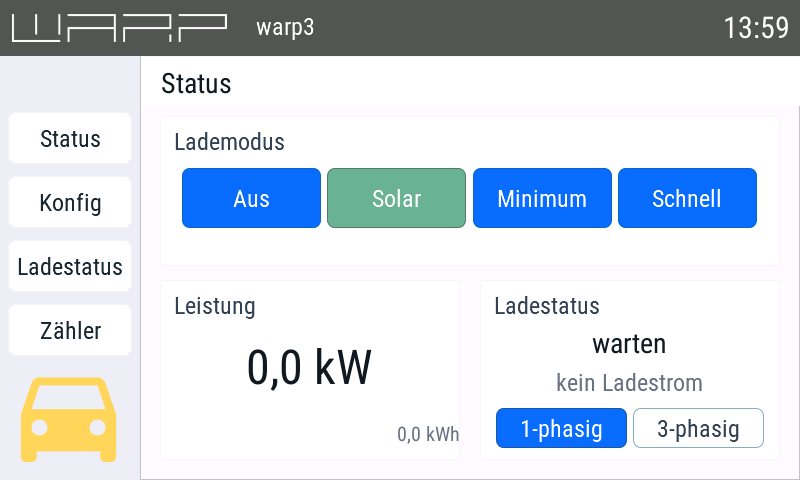
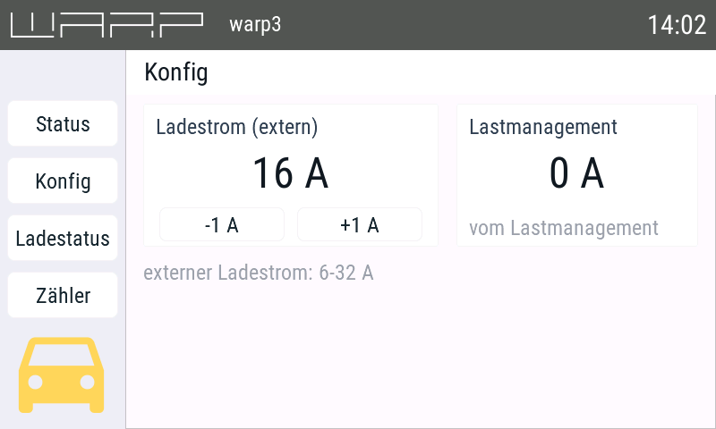

# warp-hasp-display

A touch-panel user interface for [Tinkerforge WARP](https://warp-charger.com) EV chargers,
built for [openHASP](https://github.com/HASwitchPlate/openHASP) plates with an 800×480 display.

A small [Node-RED](https://nodered.org) flow bridges the charger's MQTT API to the
openHASP MQTT protocol, so the plate shows and controls the charger exactly like the
charger's own web interface.

> **Disclaimer**
>
> This is an **unofficial community project**. It is *not* official WARP or Tinkerforge
> software, it is not affiliated with, endorsed by or supported by Tinkerforge GmbH, and it
> is not part of the charger's firmware. It only speaks the charger's publicly documented
> MQTT API — no charger code is used or modified.
>
> Charging hardware deals with high power. Verify the displayed values and the topics your
> installation writes before you rely on this display for controlling a charging session, and
> use it at your own risk.

## Quickstart

1. Copy `openhasp/pages.jsonl` to `/pages.jsonl` on the plate (web interface → *File Editor*,
   or FTP). Optionally also the header logo → `/warp-logo.png`; it is not committed, run
   `python3 tools/fetch_warp_logo.py` first (see step 1.2 below).
2. Copy `openhasp/config.example.json` through *Configuration → MQTT/Wifi Settings* and fill in
   your Wi-Fi, broker and plate name (`mqtt.name`); keep `hasp.pages` = `/pages.jsonl`
   and `hasp.startpage` = `1`.
3. Reboot the plate — the static layout shows up right away, still without live values.
4. Enable MQTT in the charger's web interface and note its topic prefix, e.g. `warp3/AbCd`.
5. In Node-RED: *Menu → Import → Clipboard*, paste `nodered/warp-display.json`. Set your broker
   in the node **controller**, set `WARP_DEV` and `HASP_PLATE` in the tab **WARP-Display** *Env*,
   then *Deploy*.
6. Check that values arrive:

   ```console
   mosquitto_sub -h <broker> -u <user> -P <password> -t 'hasp/<HASP_PLATE>/#' -v
   ```

Within a few seconds of the deploy, the display fills with values. If something stays empty,
[Installation](#installation) lists the details and where to look.



*Status page — charge mode, charging state, power, phase switch.*



*Config page — external charging current with the ±1 A buttons, load-management current.*

## Pages

| Page | Content |
|---|---|
| **Status** | Charge mode (`Off / PV / Min+PV / Fast`), charging state, power in kW (incl. remaining solar energy for today), 1‑phase / 3‑phase switch, charging icon in the sidebar |
| **Config** | External charging current (the smaller of the two current sources) with **−1 A / +1 A** buttons, current set by the load management |
| **Charging status** | IEC 61851 state, charge controller, contactor, errors, authorisation, charger temperature |
| **Meters** | Up to 5 meter slots: display name, power, charge level, phase dots |

The header (present on every page) shows the charger's logo, the device name and the clock.

## Requirements

- an [openHASP](https://github.com/HASwitchPlate/openHASP) plate with an **800×480** display
- **Node-RED** (tested with 4.0.2); the MQTT nodes are part of Node-RED itself
- a **MQTT broker** that both the plate and Node-RED can reach
- a **WARP charger** with MQTT enabled (MQTT settings in the charger's web interface)
- for current and phase switching: external control enabled on the charger

## Installation

### 1. Prepare the openHASP plate

1. Copy `openhasp/pages.jsonl` to `/pages.jsonl` in the plate's file system
   (web interface → *File Editor*, or enable *Configuration → FTP Settings* and use any FTP client).
2. Fetch the header logo and copy it to `/warp-logo.png` on the plate:

   ```console
   python3 tools/fetch_warp_logo.py          # writes openhasp/warp-logo.png
   ```

   The script downloads the official WARP logo vector file and renders it as a
   215×28 white PNG on transparent background — the exact size the header image
   object in `openhasp/pages.jsonl` expects. It needs any SVG rasteriser
   (cairosvg, `rsvg-convert`, Inkscape or ImageMagick) plus Pillow or ImageMagick;
   run it with `--list-backends` to see what it found. The logo itself is **not**
   committed here (see *Trademark*), so this step is optional: without the file the
   header just stays empty, and you can use any own 215×28 white PNG instead.
3. Adapt `openhasp/config.example.json` and save it through the web interface
   (*Configuration* → *MQTT Settings*, *Wifi Settings*, …):

   | Key | Meaning |
   |---|---|
   | `wifi.ssid`, `wifi.pass` | your Wi-Fi |
   | `mqtt.host`, `mqtt.port`, `mqtt.user`, `mqtt.pass` | your broker |
   | `mqtt.name` | **plate name** – all plate topics become `hasp/<mqtt.name>/…`; must match `HASP_PLATE` below |
   | `hasp.pages` | `/pages.jsonl` |
   | `hasp.startpage` | `1` (Status page after boot) |

4. Reboot the plate. The static layout appears immediately; live values follow as soon as
   Node-RED is running.

> `openhasp/config.json` is deliberately **not** part of this repository (it holds your
> credentials) and is ignored by git.

### 2. Enable MQTT on the charger

In the charger's web interface enable MQTT and note the **topic prefix**
(the default pattern is `warp/AbCd`, `warp2/AbCd`, `warp3/AbCd`, with a per-charger ID).
Enable *external control* if you want to set the charging current and switch phases from the
display.

### 3. Import the Node-RED flow

1. In Node-RED use *Menu → Import → Clipboard*, select `nodered/warp-display.json` and import.
   This creates the tab **WARP-Display** with 29 nodes plus an MQTT broker config node named
   `controller` (`localhost:1883` by default).
2. Open the broker node **controller** and set **your** broker host and credentials.
   If you already run a broker node, you can re-assign the tab's `mqtt in`/`mqtt out` nodes to it
   and delete `controller`.
3. Select the tab **WARP-Display** and open its *Env* (tab menu → *Env*). There is exactly one
   place where the device names are configured:

   | Variable | Meaning | Example |
   |---|---|---|
   | `WARP_DEV` | topic prefix of the charger | `warp3/AbCd` |
   | `HASP_PLATE` | plate name = `mqtt.name` in the plate config | `openhasp` |

4. *Deploy*. Within a few seconds the node **Konfiguration & Abos laden** (inject, fires on start
   and every 5 minutes) publishes the subscriptions and the display fills with values.

### 4. Check that it works

Watch the topics the flow sends to the plate:

```console
mosquitto_sub -h <broker> -u <user> -P <password> -t 'hasp/<HASP_PLATE>/#' -v
```

If values appear there but not on the display, check the `mqtt in` node of the tab (it must be
connected) and the plate name. If nothing appears at all, watch the charger side
(`mosquitto_sub -t '<WARP_DEV>/#' -v`) and check `WARP_DEV`.

## Configuration notes

- **The tab env is the only place to change.** All outgoing topics are built from the two global
  variables it sets, so changing the plate or the charger needs no other edit.
- **Dynamic subscriptions.** The `mqtt in` nodes carry no static topic field (Node-RED does not
  resolve `${…}` inside MQTT topic fields). A function node publishes `subscribe` messages instead:
  `<WARP_DEV>/#` for the charger and four targeted topics
  `hasp/<HASP_PLATE>/state/p1b42|p1b78|p2b31|p2b32` for the plate. The subscription is
  re-announced every 5 minutes, so a plate or broker restart heals itself without redeploying.
- **Charging current.** The display shows the *smaller* of `evse/external_current` and
  `evse/automation_current`. ±1 A clamps to 6–32 A and publishes the new value to both
  `evse/external_current` and `evse/automation_current_update`, based on the currently displayed
  value — the raw values of the two sources are kept separately, so no source value is
  corrupted.
- **External default.** On start (and when the hardware configuration changes) the jumper
  limit from `evse/hardware_configuration` is written to `evse/external_defaults_update`, so the
  external slot falls back to the hardware limit after a charge-controller restart.
- **Charge modes.** Display `Off / PV / Min+PV / Fast` maps to charger mode `1 / 2 / 3 / 0`.
- **Phases.** The display shows the phases actually used while charging, and the switch writes
  `phases_wanted: 1|3` to `power_manager/external_control_update`.
- **Retained values.** The charger publishes its state as retained MQTT messages, so after a
  Node-RED restart the current values arrive again immediately — no manual refresh needed.

### Two silent Node-RED traps (already handled here)

Both fail *without any error message* in Node-RED 4.x — worth knowing if you extend the flow:

1. **Several messages from a single function output** need `return [[m1, m2, m3]]`, not
   `return [m1, m2, m3]`. The index of the outer array selects the *output*; a one-output node
   silently drops everything but the first message.
2. **A router's `outputs` count must cover its highest output index.** An address beyond
   `outputs` is dropped silently, which is how `evse/automation_current` disappeared here until
   the router had 15 outputs.

## MQTT topics at a glance

| Function | Charger topic | openHASP topic |
|---|---|---|
| Charge mode | `power_manager/charge_mode` → `…/charge_mode_update` | `state/p1b42` |
| Charging state / temperature | `evse/state`, `evse/low_level_state` | `command/p1b12…`, `p3b11…p3b16` |
| Power, solar remainder | `meters/N/values`, `solar_forecast/state` | `command/p1b22`, `p1b23` |
| Phases | `evse/low_level_state` → `power_manager/external_control_update` | `state/p1b78` |
| Charging current ±1 A | `evse/external_current`, `evse/automation_current_update` | `state/p2b31`, `p2b32` |
| Load-management current | `evse/management_current` | `command/p2b27` |
| Device name | `info/name`, `info/display_name` | `command/p0b13` |
| Meters | `meters/N/values`, `meters/N/config` | `command/p4b201…` |

## Files

| File | Purpose |
|---|---|
| `openhasp/pages.jsonl` | openHASP page definitions (page 0 = header + sidebar, 1 = Status, 2 = Config, 3 = Charging status, 4 = Meters) |
| `openhasp/config.example.json` | Plate configuration template (Wi-Fi, broker, plate name) |
| `nodered/warp-display.json` | Node-RED tab **WARP-Display** – charger ⇄ plate bridge |
| `tools/fetch_warp_logo.py` | Downloads the official WARP logo and renders it as `openhasp/warp-logo.png` (215×28, white/transparent); the result is *not* committed |
| `docs/` | Screenshots |

The node labels and the comments inside `nodered/warp-display.json` are in German; this
documentation is in English.

## License

MIT — see [LICENSE](LICENSE).

The MIT license covers the code and configuration in this repository
(`openhasp/pages.jsonl`, `openhasp/config.example.json`, `nodered/warp-display.json`,
`tools/fetch_warp_logo.py`). It does **not** cover the WARP logo (see below).

### Trademark

The WARP logo is a trademark of Tinkerforge GmbH. This repository does not distribute
it: `tools/fetch_warp_logo.py` downloads the original vector file from Tinkerforge's
public sources and renders it locally, so the logo only exists as a build artefact
(`openhasp/warp-logo.png`, git-ignored). Use it solely to identify which charger the
display belongs to, and delete it in favour of your own image if you prefer.

### Credits

- [openHASP](https://github.com/HASwitchPlate/openHASP) by Francis Van Roie (MIT) — the display
  firmware and its MQTT/JSONL page format
- [Node-RED](https://nodered.org) (Apache-2.0)
- WARP charger MQTT API, documented by Tinkerforge